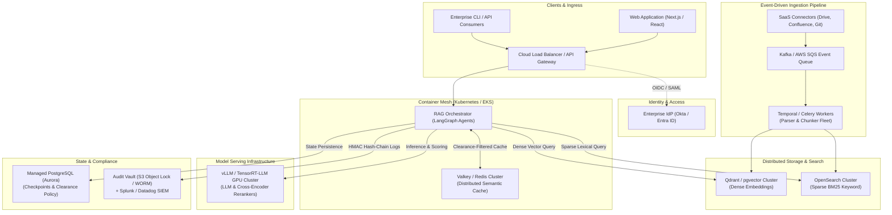

# Local Enterprise RAG Lab

[](#)
[](#)
[](#)
[](#)
[](#)

An enterprise-grade, fully local **Compound AI** retrieval, reasoning, and governance platform built with **LangGraph**, **Ollama (`qwen3:8b`)** or any OpenAI-compatible server (vLLM), **ChromaDB** (with opt-in Qdrant / pgvector), **SQLite FTS5 / BM25**, and **PostgreSQL / SQLite**.

Designed for complete data sovereignty, this system operates **100% air-gapped** (`HF_HUB_OFFLINE=1`) with zero external network requests during inference. It integrates hierarchical document clearance (Policy v3 RBAC), pre-execution PII redaction, self-reflective corrective RAG loops, multi-format document ingestion, and compliance-grade Human-in-the-Loop (HITL) review gates.

---

### Architectural Principles & Evaluation Scorecard

| Pillar | Principle | Score | Architectural Implementation |
|:---|:---|:---:|:---|
| **Zero Trust** | **Explicit Node Verification** | **9 / 10** | Tokens, workspace permissions, and dual-control reviewer rules are enforced directly inside graph nodes, never delegated to client state. |
| **Zero Trust** | **Fail-Closed Retrieval** | **9 / 10** | Server-side clearance filtering backed by base-class `guard_hits()`; unknown clearances drop files; missing keys halt execution. |
| **Zero Trust** | **Tamper-Evident Audit** | **8.5 / 10** | Forward-secure HMAC-SHA256 hash chain with AES-256-GCM sealed payloads; signed head anchors replicated to off-host copies (`AUDIT_ANCHOR_COPY_DIR`). |
| **Zero Trust** | **Caller Isolation & DLP** | **8.5 / 10** | `prepare_pipeline_input()` sanitizes queries before state serialization; initial checkpoints and audit logs never persist unredacted PII. |
| **Zero Trust** | **Cryptographic Supply Chain** | **8.5 / 10** | Model weights pinned by hardcoded SHA-256 digests; all 164 package dependencies cryptographically hash-pinned in `requirements.lock`. |
| **Zero Trust** | **Network Boundary & Transport** | **8 / 10** | UI binds loopback `127.0.0.1` by default; network access requires explicit opt-in (`LAN=1`); local CA TLS via Caddy ([docs/lan-tls.md](docs/lan-tls.md)). |
| **AI Systems** | **Compound Architecture** | **9 / 10** | Directed acyclic & cyclic LangGraph state machine with explicit retry budgets and decoupled retrieval/grading nodes. |
| **AI Systems** | **Reproducibility** | **9 / 10** | Pinned ONNX models; fp32 NLI yielding identical cross-entropy scores on arm64 and x86; deterministic extractive baseline. |
| **AI Systems** | **Doc & Code Fidelity** | **9 / 10** | Automated CI tests enforce that architecture diagrams, Makefile commands, and golden set metrics match codebase reality. |
| **AI Systems** | **Groundedness & Output Gates**| **8.5 / 10** | Quantitative figure extraction and cross-lingual NLI sentence entailment (`mDeBERTa-v3`) with self-corrective prompt feedback. |
| **AI Systems** | **Tunability & Feedback Loop** | **8.5 / 10** | Parametric candidate retrieval widths (`RETRIEVAL_*_K`); automated harvesting of reviewer compliance rejections (`make audit-harvest`). |
| **AI Systems** | **Evaluation Benchmark** | **8.5 / 10** | 159 golden benchmark cases (108 held-out test split) across 4 languages with committed reference baselines ([eval/README.md](eval/README.md)). |

*Full security threat model and cryptographic boundaries: see [docs/threat-model.md](docs/threat-model.md).*  
*Interactive visual guides: see [Beginner Guide](docs/beginner-guide.html) and [Concept Map](docs/concept-map.html).*  
*Horizontal scaling and containerized cloud deployment options: see [docs/scaling.md](docs/scaling.md).*

---

### Quickstart (Zero Cloud Keys Needed)

Clone the repository and run the test suite locally in under 3 minutes:

```bash
make setup          # Create virtualenv and install dependencies
make models         # Download and verify pinned SHA-256 ONNX models offline
make test           # Run the full test suite (1,000+ tests, offline)
make eval           # Run 159-case golden evaluation gate
make ui             # Launch Streamlit web interface (binds 127.0.0.1)
```

---

---

## Implemented AI Engineering Concepts

This repository serves as a reference implementation for key AI engineering patterns and production RAG architectures:

### 1. Compound AI Systems Architecture
Rather than treating LLM calls as a monolithic black box, the system orchestrates specialized, modular components: deterministic guardrails, semantic caching, intent routers, hybrid retrievers, document & hallucination graders, response generators, and compliance checkpoints.

### 2. Cyclic Agentic State Machines (LangGraph)
Uses **LangGraph** to model the RAG pipeline as a directed state graph (`GraphState`) featuring conditional branching, state cycles (retries and query rewriting loops), and durable execution interruptions.

### 3. Self-Reflective RAG (Self-RAG)
Implements dynamic self-assessment loops to verify output quality before answers are finalized:
* **Document Relevance Grading (`retrieve` + `grade_docs`)**: the evidence gate in `retrieve` (see Retrieval Abstention & Evidence Thresholds) keeps only chunks that clear the profile's relevance threshold; `grade_docs` then checks that any survived and otherwise routes to `rewrite`.
* **Hallucination Detection (`grade_hallucination`)**: Rejects figures the sources do not contain, then checks each answer sentence with a local, full-precision multilingual entailment (NLI) model (`mDeBERTa-v3-base-xnli-multilingual-nli-2mil7`, scores identical on arm64 and x86): a sentence passes only if a source sentence states it, in any of English, German, French, or Greek, including across languages. A rejected answer is regenerated with the unsupported sentence named.
* **Answer Relevance Grading (`grade_relevance`)**: Assesses whether the final answer directly addresses the original user prompt.

### 4. Corrective RAG (CRAG) & Adaptive Query Rewriting
When retrieved documents fail relevance grading or an answer is found irrelevant, the pipeline autonomously reformulates the user query (`rewrite`) and retries retrieval.

An answer that fails the groundedness check is regenerated from the same documents with the grader's reason added to the prompt (for example, the figures it stated that the context does not contain), because at temperature 0 an identical prompt would only repeat the same answer. The extractive fallback is never retried: it escalates straight to review. Two separate **circuit breakers** bound the loops: `MAX_RETRIEVAL_RETRIES` (default 2) for query rewrites and `MAX_GENERATION_RETRIES` (default 1) for regenerations, so one loop cannot spend the other's budget. Deployments running larger models can raise them in `.env`.

### 5. Hybrid Retrieval, GraphRAG & Cross-Encoder Reranking
Combines dense vector embeddings, sparse lexical search, in-process knowledge graph traversal, and neural cross-encoder reranking:
* **Dense Retrieval**: Cosine similarity via ChromaDB and in-process ONNX embeddings. `MODEL_PROFILE` picks the models: `multilingual` (default; `paraphrase-multilingual-MiniLM-L12-v2` + `bge-reranker-v2-m3-int8`, about 0.8 GB), `multilingual-large` (`multilingual-e5-large` + `bge-reranker-v2-m3`, about 4.5 GB, slower, marginally better), or `en` (`bge-small-en-v1.5` + `ms-marco-MiniLM-L-6-v2`, English only). Documents and questions may be in English, German, French, or Greek, in any combination.
  Models never switch automatically: each index records the model that built it, and retrieval skips dense search with a labelled warning until the workspace is re-indexed (`make sync FORCE=1`). `make status` marks such a workspace `[!!]`, and an answer built on it, including a "not found" abstention, waits for a reviewer instead of releasing on its own. Every profile also downloads the 1.1 GB NLI model (default profile: about 2 GB in all). There is no Ollama embedding path: it failed the multilingual gates, could not be hash-pinned and was slower (measurements in [eval/README.md](eval/README.md)); a leftover `EMBEDDING_PROVIDER=ollama` fails with instructions.
* **Sparse Retrieval**: Lexical term matching via SQLite FTS5 / BM25 for exact matches, technical acronyms, and identifiers.
* **Graph-Augmented Retrieval (GraphRAG - `rag_lab/retrieval/graph_store.py`, `rag_lab/ingestion/graph_builder.py`)**: Zero-dependency, in-process Knowledge Graph built during workspace ingestion. Automatically extracts corporate entity relationships (people, roles, policies, services, authorities) across English, German, French, and Greek. Resolves multi-hop bridging queries where lexical or vector similarity alone misses intermediate linking documents (e.g. *Person* $\rightarrow$ *Role* $\rightarrow$ *System Authority* $\rightarrow$ *Access Ticket*). Configurable via `ENABLE_GRAPH_RAG=1`, `GRAPH_MAX_HOPS=2`, or toggled on demand in the Streamlit UI with an interactive traversal path visualizer.
* **Reciprocal Rank Fusion (RRF)**: Merges dense, sparse, and graph traversal candidate sets into an initial top candidate list.
* **Neural Cross-Encoder Reranker (`rag_lab/retrieval/reranker.py`)**: Shortlisted candidates undergo deep cross-attention re-scoring with a local, pinned ONNX model (per profile) to ensure that chunks directly answering the query are prioritized above partial keyword distractions while preserving graph-bridging evidence.

### 6. Retrieval Abstention & Evidence Thresholds ("Knowing When Not to Answer")
To prevent hallucinations on irrelevant context, the system enforces strict evidence thresholds:
* The gate is per model profile (calibrated with `make calibrate-models`). The default `multilingual` profile requires the cross-encoder reranker's best score to reach its threshold; the `en` profile requires cosine similarity $\ge 0.65$; either falls back to similarity or query keyword coverage when no reranker score exists.
* If retrieved chunks fail these criteria, the system cleanly **abstains** (explaining that documentation was not found) instead of fabricating answers from unrelated context. System abstention notices, clearance access denials, and compliance rejection banners are localized into Greek, German, French, and English, matching the question without language bleed.

### 7. State-Scoped & Clearance-Partitioned Semantic Caching
* Approved answers and their citations are stored sealed (AES-256-GCM) in a persistent SQLite cache with a bounded in-memory L1 in front (`CACHE_BACKEND=postgres` shares one table instead). Lookup is two-stage: an exact match on a composite key, `hashlib.sha256(f"{workspace_id}:{clearance}:{index_version}:{normalized_question}")`, then a cosine match inside the same partition, which also requires the same numbers, negations and language.
* Partitioning by user clearance ensures a lower-clearance user never hits a cached answer generated from higher-clearance documents, while keying on `original_question` ensures queries rewritten during CRAG loops still hit the cache on subsequent asks.
* Re-indexing or updating documents automatically rotates `index_fingerprint`, guaranteeing instant cache invalidation with zero stale data served.

### 8. Dynamic Intent Classification & Routing
An intent router classifies incoming queries into **domain RAG** vs. conversational **chitchat**, bypassing vector retrieval for general interactions to conserve compute and avoid noise.

### 9. AI Safety, Prompt Injection Defense & Outbound DLP
* **Direct & Indirect Prompt Injection Defense**: Pre-retrieval heuristics detect direct user jailbreaks (`guardrail`). Post-retrieval context scanning (`sanitize_context`) strips untrusted documents containing role spoofing, delimiter attacks, instruction overrides, and exfiltration beacons prior to generator evaluation.
* **Real-Time Outbound Data Loss Prevention (DLP)**: Generated LLM responses undergo real-time redaction for emails, phone numbers, and sensitive identifiers before release. Audit logs are cryptographically hash-chained and PII-masked.

### 10. Human-in-the-Loop (HITL) Compliance & Dual-Control Gates
* The state graph pauses before answer release at a compliance checkpoint node.
* **Dual-Control Enforcement**: Reviewers must authenticate to approve or reject responses, and requesters are strictly prohibited from approving their own queries.
* Workflows can be resumed via either the web interface or terminal CLI (`rag_lab/ops/approve.py`).

### 11. Deterministic Source Provenance & Citations
Every answer sentence is tied back to traceable chunk keys (`[workspace_doc_chunk]`) and original source files, rendered in the UI with expandable citation cards for instant auditability.

### 12. Offline Benchmarking & LLM-as-a-Judge Evaluation Gate
An offline evaluation suite (`rag_lab/ops/eval.py`, `rag_lab/ops/eval_metrics.py`) benchmarks retrieval precision, keyword recall, groundedness, answer rate, and abstention accuracy against golden evaluation datasets (`eval/golden.json`), with optional LLM-as-a-judge support checks.

### 13. Multi-Tenant Knowledge Isolation & Document-Level RBAC
* **Workspace Isolation**: Workspaces (e.g., `accounting`, `legal`, `engineering`) are partitioned into isolated vector collections (`ws_<workspace_id>`) and independent SQLite FTS5 indices, preventing cross-tenant data leakage.
* **Document-Level Clearance Filtering**: Documents declare hierarchical clearance tags (`public`, `internal`, `confidential`, `secret`) in frontmatter or headers (unrecognized tags fail closed during ingestion). Vector search (`ChromaDB where` + post-query guard) and keyword search (`SQLite FTS5 WHERE clearance IN (...)`) strictly enforce the caller's authorized clearance, rendering classified documents completely invisible to unauthorized users.

### 14. Model Weight Pinning, Native Rust Acceleration & Graceful Degradation
* Embedding, cross-encoder reranker and NLI weights are verified against pinned SHA-256 hashes (`rag_lab/security/model_integrity.py`). The NLI model is pinned in full precision on purpose: its int8 sibling scored one true sentence 0.93 on Apple silicon and 0.12 on x86 Linux (details in [eval/README.md](eval/README.md)).
* **Native Rust Accelerator (`crates/rag_accel`)**: the prompt-injection scan (`RegexSet` single-pass automaton, 24x faster than the Python regexes on 1,000 chunks: 0.87 ms against 21.2 ms; a later best-of-three re-run measured 0.37 ms against 14.4 ms, 39x, so the factor varies with the machine and the run) with verdict and reason parity, from the same pattern file as the Python scanner. It is the default, with a fallback that is never quiet: `RAG_ACCEL=preferred` (default) uses it when installed and otherwise falls back to the pure-Python scanner with one warning on stderr, and `make status` shows `[!!] DEGRADED`; `RAG_ACCEL=required` refuses to start without it. `make setup` installs it for you, in order: a prebuilt wheel from `wheelhouse/`, a build from source when `cargo` exists, else the fallback. The `wheels` GitHub workflow builds one abi3 wheel per platform (macOS arm64 and x86_64, Linux x86_64 and aarch64) that serves Python 3.11 and later; download the artifact for your platform into `wheelhouse/` and run `make setup`. There is no native chunker: chunking was 0.05 s of a 91 s ingest.
* If the primary LLM, cross-encoder, or vector store is unreachable, the system enters a degraded mode with transparent extractive fallbacks and visible warnings rather than failing silently.
* **Measured performance** (Apple M-series, 150 documents / 4,055 chunks, idle machine, before to after). Ingest: a full sync 79.6 s to 69.9 s; a re-sync with nothing changed 7.97 s to 0.02 s; a re-sync after editing one file 78.8 s to 3.7 s. Re-syncs embed only chunks whose text is new and reuse the stored vector of every other chunk (same workspace, same model, same prefix; `FORCE=1` recomputes everything), and plain-text files are decoded in-process instead of in a sandboxed child (the sandbox stays for every other format). Embedding is over 80% of a full sync and runs at about 55 to 60 chunks/s however it is batched: one batch size, thread count or worker-process setting after another was no faster. Query: a question that misses a cache of 2,000 answers spent 217 ms in the cache before and 5 ms now (57.5 ms to 4.1 ms at 500), so such a query takes 243 ms instead of 476 ms; with an empty cache nothing changes. The semantic cache searches one matrix per (workspace, clearance, index version) partition, only the clearances the caller may read, and re-reads and re-verifies the winning row before it answers.

---

## Architecture Flow

```
[START]
   │
[guardrail] ──(fail)──> [END] (Adversarial Prompt Violation)
   │ (pass)
[contextualize] (Follow-up questions rewritten as standalone questions)
   │
[cache_lookup] ──(hit)──> [END] (Direct Semantic Cache Hit)
   │ (miss)
[router] ──(chitchat)──> [chitchat] ──> [END]
   │ (rag)
[retrieve] (Hybrid ChromaDB Dense + SQLite FTS5 / BM25 Sparse)
   │
[sanitize_context] (Zero Trust Indirect Prompt Injection Defense)
   │
[grade_docs] ──(rewrite)──> [rewrite] ──> [retrieve]
   │ (approved / max retries)
[generate]
   │
[grade_hallucination] ──(retry + grader feedback)──> [generate]
   │ (grounded)          └──(circuit break)──> [human_approval]
[grade_relevance] ──(irrelevant)──> [rewrite]
   │ (relevant / circuit break)
[human_approval] (HITL Compliance Checkpoint)
   │
 [END]
```

The generated topology is [`docs/architecture.mmd`](docs/architecture.mmd) (`make graph`); a test fails when it no longer matches the code.

---

## Usage Instructions

### 1. Prerequisites & Environment Setup

* **Python**: `>= 3.11` (tested up to 3.14)
* **Ollama** (optional, recommended for local generative LLM): `make ollama-pull` pulls the chat model (`qwen3:8b`, about 5 GB); embeddings, reranking and entailment run in-process, no Ollama needed. Any OpenAI-compatible server (vLLM, LM Studio, llama.cpp) works too: `LLM_PROVIDER=openai`, see [docs/scaling.md](docs/scaling.md)
* **Rust Toolchain** (optional: only to build the native `rag_accel` extension when no prebuilt wheel fits your platform)
* **Docker** (optional: the PostgreSQL checkpointer, the Qdrant / pgvector / vLLM profiles, LAN TLS)

```bash
# 0. View all available make commands
make help

# 1. Create virtual environment and install dependencies
make setup

# 2. Download and verify the pinned embedding, reranker and NLI models (about 2 GB; requires network once)
make models

# 3. Verify cached model weights offline
make verify-models

# 4. (Optional) Build the native Rust accelerator from source. 'make setup' already installed a prebuilt wheel
#    from wheelhouse/ or built it when cargo exists; 'make status' says which, or that it is degraded.
make rust-build

# 5. Inspect full system status (models, accelerator, LLM, RBAC, workspaces, audit health)
make status
```

---

### 2. User Accounts & Role-Based Access Control (RBAC)

Nothing is reachable without a signed-in account. Passwords are hashed with **scrypt** with automatic hash upgrades.

**Roles.** Every account has a role, a named bundle of permissions: `owner` and `admin` (all permissions plus administration of accounts, groups, grants and workspaces), `reviewer` (query, review), `trusted` (query, auto_approve), `member` (query) and `none`. The first administrator is the `owner`; only an owner can assign or remove the owner role, and the last owner cannot be removed. An account without a role of its own follows the **default role**. Clearance is separate from roles.

**Groups** hold a role per workspace (or on `all` workspaces, including future ones), and accounts belong to groups. Permissions on a workspace resolve from the most specific source: the account's own grant on that workspace, then its own grant on all workspaces, then its groups' grants (combined, but any group's `none` denies), then its role, then the default role.

**Review modes.** A fresh install runs in **open** mode: the default role is `trusted` (`query` + `auto_approve`), so every account can chat on every workspace and answers that pass every automated check are released without a person reading them. Answers that fail a check still pause for review. For team use, appoint at least one reviewer and run `make team-mode ADMIN=<admin>`: it moves the default role from `trusted` to `member`, so answers wait for a reviewer unless an account holds `auto_approve` through its role, groups or grants. `make status`, `make users` and the admin panel show the current mode, and flag workspaces where a paused answer could not be decided (no reviewer, only the requester as reviewer, or no reviewer cleared as high as the requester), and warn when a shared install in open mode has confidential or secret documents indexed. Adding an account (from the second one on, you are asked for its role) prints the same warning when it leaves answers nobody can approve. As the team grows, `make status` suggests the next step (team mode, groups, a second owner); it never changes anything itself.

**Upgrading.** A policy file from an earlier version is migrated on first load, after its signature verifies: administrators become `owner` (the first alphabetically) or `admin`, the old defaults become the default role (or stay a custom permission set), and nobody's effective access changes. Where an administrator's new role would grant more than they held, their old access is pinned as an explicit grant on all workspaces. The old file is kept beside the new one as `access_policy.json.v2-<timestamp>.bak`, and the migration is written to the audit log. A file that fails its signature is refused and left untouched.

**Two-factor sign-in (optional, owners and administrators).** `make totp-enroll ADMIN=<you>` (or the sidebar panel) adds a TOTP secret to an authenticator app, confirms it with a code, and prints ten single-use recovery codes. From then on that account needs the code at every sign-in: the UI form, `--as` commands, `make sync`, and review sign-ins. The code is asked for only after the password verifies, a wrong code counts toward the lockout, and a code works once (replay-protected). The secret is stored sealed, bound to the account. Enforcement follows the enrolment, so a demoted administrator keeps it. Turn it off with `make totp-disable` (needs a code); an owner can reset another account's, which signs that account out. If no code is left to use, see *When someone is locked out* below: every case has an administrator-run fix, including a sole owner's.

**When someone is locked out.** Each case has a fix run by an administrator, or by whoever operates the machine:

| Situation | Who fixes it | How |
|---|---|---|
| Lost the authenticator, still has a recovery code | the user | sign in with the recovery code, then `make totp-recovery` or `make totp-disable` |
| Lost the authenticator and the codes: an administrator | an owner | `make totp-disable ADMIN=<owner> ACCOUNT=<them>` (or the owner's sidebar panel) |
| Same, for an owner, when another owner exists | the other owner | the same command |
| Same, for a sole owner | the machine operator | `make recover ACCOUNT=<them> RESET_TOTP=1` |
| Forgot the password: a member or an administrator | any administrator | `make set-password ACCOUNT=<them> ADMIN=<admin>` |
| Forgot the password: an owner | another owner | the same command (an administrator cannot reset an owner's password) |
| Forgot the password: a sole owner | the machine operator | `make recover ACCOUNT=<them> RESET_PASSWORD=1` |
| Locked out by five failed sign-ins | nobody needed | the lockout ends by itself within 15 minutes |
| Lost the access or data key | nobody | the policy and sealed data cannot be read without it: restore the key from custody (see *Where the keys live*) |

`make recover` is the break-glass: it needs no sign-in (the account cannot sign in), runs only from a terminal, asks you to type the account name back, resets the second factor and/or sets a new password, signs the account out everywhere, and writes `account_recovered_local` to the audit log. It exists on the command line only, never in the UI. It is not a new weakness: the key that signs the policy is readable only by the OS user running it, so anyone who can run it could already rewrite the policy by hand, without a trace. Restoring an old policy backup instead is a bad recovery plan, because it brings back deleted accounts and revoked sessions. On a shared host where the machine's operators are not all trusted, set `LOCAL_RECOVERY=off`; a sole owner's lockout then has no remedy.

**Where the keys live.** The access key (signs the policy and session tokens) and the data key (seals audit payloads, checkpoints and the cache, and keys the audit chain) go into the OS keychain when one is usable (macOS Keychain, Windows Credential Locker, Secret Service or KWallet); the key file then holds only a pointer. Where there is no keychain (headless Linux, containers, CI) they stay in owner-only files, and `make status` says so. Existing key files stay files until you run `make migrate-keys` (`REVERSE=1` moves them back). **`make backup` excludes keys, and a key held only in the keychain is lost with it (an OS reinstall, a keychain reset), taking the audit log, checkpoints and policy with it: keep a copy in custody** (`make migrate-keys REVERSE=1` writes the key files back). `KEY_STORE=auto|file|keyring` chooses the home of a new key; envelope encryption through Vault or a KMS has an interface and a stub (`rag_lab/security/keystore.py`) but no implementation. On macOS the keychain item belongs to the Python binary that created it: a rebuilt `venv`, or a different interpreter, can prompt or be refused, and a background process cannot answer a prompt (`KEY_STORE=file` avoids it).

**Audit anchors.** Set `AUDIT_ANCHOR_COPY_DIR` to a second location and every anchor is written to both; `make audit-verify` checks both and compares them (see the audit section).

All operations can be managed directly via `make` commands without activating the virtual environment:

```bash
# Create an administrator account (the owner; required for indexing and sync)
make add-user ACCOUNT=alice ADMIN=1

# Create accounts with a role and clearance level (public, internal, confidential, secret)
make add-user ACCOUNT=bob ROLE=reviewer CLEARANCE=internal ADMIN=alice
make add-user ACCOUNT=charlie ROLE=member CLEARANCE=public ADMIN=alice

# Change a role ('default' follows the default role) or a clearance level
make set-role ACCOUNT=charlie ROLE=trusted ADMIN=alice
make set-clearance ACCOUNT=bob CLEARANCE=confidential ADMIN=alice

# Groups: a role per workspace for everyone in the group
make create-group GROUP=finance-team ADMIN=alice
make add-to-group ACCOUNT=charlie GROUP=finance-team ADMIN=alice
make grant-group GROUP=finance-team WS=accounting ROLE=reviewer ADMIN=alice
make groups

# Per-account overrides on workspaces ('query', 'review', 'auto_approve', or a ROLE=)
# Accepts a single workspace, comma-separated list, or 'all'
make grant ACCOUNT=bob WS=accounting,strategy PERMS=query,review ADMIN=alice
make grant ACCOUNT=charlie WS=all ROLE=member ADMIN=alice

# Revoke access to workspaces (accepts a single workspace, comma-separated list, or 'all')
make revoke ACCOUNT=charlie WS=accounting ADMIN=alice
make revoke ACCOUNT=bob WS=all ADMIN=alice

# List accounts, roles, groups, clearance, and overrides (never displays hashes)
make users

# Require human review by default once a reviewer is appointed
make team-mode ADMIN=alice

# Reset an account password (prompts securely)
make set-password ACCOUNT=bob

# Delete an individual user and all their grants
make delete-user ACCOUNT=bob
# Or bypass confirmation prompt:
make delete-user ACCOUNT=bob YES=1

# Delete ALL user accounts and grants
make reset-users
# Or bypass confirmation prompt:
make reset-users CONFIRM=yes
```

---

### 3. Workspace Management & Document Ingestion

Place `.md`, `.txt`, `.pdf`, `.docx`, or other supported files in dedicated folders under `knowledge_base/<workspace>/` (or manage workspaces directly via `make`):

```bash
# List all workspaces with file counts, chunk counts, and FTS5 index status
make workspaces

# Create or delete a workspace from the CLI
make create-workspace WS=legal
make delete-workspace WS=legal YES=1

# Sync all workspace directories (requires admin credentials)
make sync ADMIN=alice

# Sync a single workspace (auto-discovers knowledge_base/<ws>/ or accepts a custom DIR, which needs WS; optional FORCE=1)
make sync ADMIN=alice WS=accounting
make sync ADMIN=alice WS=accounting DIR=./knowledge_base/accounting FORCE=1
```

* Workspaces are automatically sanitized (e.g., `Accounting & Tax` becomes `accounting_tax`).
* Generates Chroma collections (`ws_<workspace_id>`) and SQLite FTS5 keyword indexes (`bm25_indices/<workspace_id>.db`).
* Idempotent: unchanged files are automatically skipped based on SHA-256 manifests (a parser or chunker change bumps `CHUNKER_VERSION`, so the next sync re-indexes everything once).
* Tables (DOCX, PPTX, XLSX, CSV) are written one row per line with the column names on every row (`Grade: G5 | Hotel cap EUR: 240`), so a chunk holding one row still says what each value is. DOCX keeps paragraphs and tables in document order and turns Heading styles into `#` lines, so chunks carry their section. PDFs are chunked page by page, so every chunk and citation carries its page (`annual.pdf (p. 12)`, the `page` metadata field); a sentence that crosses a page break is split there. A PDF with no text layer is refused with a note, and blank pages inside one are skipped with a warning.
* **Limits (by design, to stay simple and offline):** PDF extraction is plain text through `pypdf`: no OCR, no layout analysis, so tables inside a PDF flatten to running text and multi-column pages can read out of order. Headings are recognised in Markdown and DOCX only. Images, charts and legacy `.doc`/`.xls`/`.ppt` are not read. For those, run OCR first or export the table to XLSX/CSV.

---

### 4. Interactive Web Application

Launch the Streamlit web interface:

```bash
make ui ADMIN=alice
# Or launch without re-indexing (binds to 127.0.0.1 by default; LAN=1 to expose to network):
make ui
make ui LAN=1
```

Open `http://localhost:8501` in your browser:
1. **Sign In**: Authenticate with your username and password to obtain an HMAC-signed session token.
2. **Select Workspace**: Switch between permitted workspaces in the sidebar.
3. **Ask Questions**: Submit natural language queries.
4. **Inspect Citations**: Expand citation cards beneath responses to verify exact chunk origins and document text.
5. **Human Review Drawer**: If an answer requires compliance sign-off, authorized reviewers can approve or reject the output directly in the UI.

---

### 5. Compliance Review (Human-in-the-Loop)

Pending Human-in-the-Loop review threads can be managed directly via `make` commands. Under Separation of Duties, a query must be approved by an authorized reviewer with `review` permissions other than the requester:

```bash
# List all threads awaiting compliance approval
make reviews

# Interactively review a paused thread (prompts to approve/reject and records decisions)
make review
# Or specify a thread and reviewer:
make review THREAD=ui-accounting-uuid ACCOUNT=bob

# Directly approve a paused thread
make approve THREAD=ui-accounting-uuid ACCOUNT=bob REASON="Verified against policy"

# Directly reject a paused thread
make reject THREAD=ui-accounting-uuid ACCOUNT=bob REASON="Outdated policy cited"
```

---

### 6. Security, Auditing & Governance Operations

All system events (queries, guardrail checks, retrievals, and human decisions) are committed to a tamper-evident, append-only SQLite audit log (`data/audit.db`) with AES-256-GCM encrypted payloads.

```bash
# Verify the cryptographic HMAC audit hash chain
make audit-verify

# Inspect recent audit events (optional N=<count> and WS=<workspace>)
make audit-tail
make audit-tail N=50 WS=accounting

# Inspect answers rejected by human reviewers along with reasons
make audit-feedback
make audit-feedback N=20 WS=accounting

# Export rejected answers as candidate eval cases for eval/golden.json (feedback loop)
make audit-harvest
make audit-harvest N=50 OUT=eval/feedback_candidates.json

# Anchor the audit head hash (run periodically to detect truncation; after a retention prune the new chain base carries a keyed integrity tag, so `make audit-verify` also flags a base edited to hide deleted records). Set AUDIT_ANCHOR_COPY_DIR to a second
# location (another disk, a mounted share): every anchor is written to both, `make audit-verify` checks both and
# compares them, so deleting or rewinding the anchor file on this host is detected. If the copy cannot be
# updated (an unmounted drive), the command exits non-zero; the primary anchor is still recorded.
make audit-anchor

# Export decrypted audit trail as JSONL (to stdout or OUT=<file>)
make audit-export OUT=audit-export.jsonl

# Apply data retention policy (prunes audit logs and idle threads > 183 days by default)
make retention
make retention DAYS=90

# Create, list, and verify consistent checksummed snapshot backups (keys excluded)
make backup
make backups
make backup-verify DIR=backups/backup-<timestamp>

# Zero-trace factory reset (wipes all users, audit logs, checkpoints, keys, vectors, and the source documents in knowledge_base/ and uploads/)
make factory-reset
# Or bypass confirmation prompt:
make factory-reset CONFIRM=yes
```

---

### 7. Evaluation & Test Suite

Verify system health, offline compliance, and retrieval quality:

```bash
# Run full unit and integration test suite
make test

# Run test suite with all outbound sockets blocked
make test-offline

# Static gates
make lint
make typecheck

# Run offline RAG benchmark evaluation (eval/golden.json)
make eval

# Run evaluation with local Ollama LLM-as-a-judge support checks
make eval-judge

# Print retrieval similarity and keyword coverage signals on the calibration split
make eval-calibrate

# Export LangGraph architecture diagram to docs/architecture.mmd
make graph
```

About 1,000 tests. Services are optional locally: a test that needs PostgreSQL, Qdrant or pgvector probes it and skips when it is not running. GitHub Actions (`.github/workflows/ci.yml`) runs lint, mypy and the whole suite twice (online, then with sockets blocked) against real PostgreSQL, Qdrant and pgvector services and fails instead of skipping; a run takes about 20 minutes. The `wheels` workflow builds the Rust accelerator wheels.

---

### 8. Storage Architecture & Docker Evaluation

The engine supports two storage topologies for persisting LangGraph conversation state and checkpoints:

#### Default Mode: Embedded SQLite (Zero-Ops & Self-Contained)
* **Status:** Default out-of-the-box (`data/checkpoints.db`).
* **Operational Footprint:** **Zero Docker required.** Checkpoints, audit trails (`data/audit.db`), and FTS5 keyword indices run natively as embedded SQLite databases with Write-Ahead Logging (WAL) and AES-256-GCM encryption-at-rest.

#### Optional Mode: PostgreSQL via Docker Compose (`make up`)
The repository includes a `docker-compose.yml` to run PostgreSQL (`postgres:16-alpine`) as an external checkpointer (`DB_URI=postgresql://...`).

**Credentials.** There is no password in the repository. `make up` creates `.env` (mode 600, git-ignored) with a random `POSTGRES_PASSWORD` the first time; `docker-compose.yml` reads it through `${POSTGRES_PASSWORD}` and refuses to start without one. The server listens on `127.0.0.1` only. To use it as the checkpoint store, uncomment the `DB_URI` line in `.env` (it expands `${POSTGRES_USER}` and `${POSTGRES_PASSWORD}`). The PostgreSQL tests use `POSTGRES_TEST_URI`, or the credentials in `.env`.

**Scaling options (all off by default).** Qdrant or pgvector as the vector store, vLLM or any OpenAI-compatible server as the chat model, a PostgreSQL-backed semantic cache shared by several UI processes, each a compose profile started with `make scale-up SERVICE=<name>` that `make up` never starts: see [docs/scaling.md](docs/scaling.md), including the measurements and what does **not** scale (the keyword index, the audit log and the policy stay local files).

**HTTPS on a LAN.** `make ui` serves plain HTTP and binds to `127.0.0.1` by default (opt-in for the network with `make ui LAN=1`). For colleagues on a network there is an optional Caddy proxy with a local CA (`make lan-tls`, a compose profile that `make up` never starts): see [docs/lan-tls.md](docs/lan-tls.md).

**Upgrading from an earlier version.** The old compose file used a fixed password, and PostgreSQL applies `POSTGRES_PASSWORD` only when a volume is first created. After `make up` has created `.env`, run `make db-password` once: it sets the existing role's password to the one in `.env` over the container's local socket (the data is untouched). Starting fresh instead (`docker compose down -v`) deletes the volume and its checkpoints.

**Is Dockerized PostgreSQL "Enterprise-Ready"?**
* **For Small Teams (1 to ~30 people / Internal Air-Gapped Labs):**
  - **Verdict:**  **Practical & Recommended.**
  - Provides instant, reproducible database provisioning without cloud infrastructure overhead or cloud egress costs.
  - State is persisted to a Docker volume (`pgdata`), easily backed up via standard host snapshots or `pg_dump` jobs.
* **For Large Enterprise Teams (50+ to Thousands of users):**
  - **Verdict:** ⚠️ **Single-container Docker is NOT enterprise-ready.**
  - A standalone container on a single host lacks **High Availability (HA)**, automatic multi-AZ failover, read replica scaling, and point-in-time recovery (PITR).
  - **Recommended Enterprise Alternative:** Large enterprises should point `DB_URI` to a **Cloud-Managed Service** (AWS Aurora/RDS, GCP Cloud SQL, Azure Database for PostgreSQL) or deploy PostgreSQL via a **Kubernetes Database Operator** (e.g. [CloudNativePG](https://cloudnative-pg.io/) or [Crunchy Data PGO](https://access.crunchydata.com/documentation/postgres-operator/latest/)) with continuous WAL archiving (`pgBackRest` / `wal-g`).

---

## 9. Scaling Beyond a Single Host: Cloud Architecture & Modern Stack

While **Local Enterprise RAG Lab** is engineered as a zero-cost, self-contained appliance for local workstations and air-gapped team servers, growing organizations often face requirements that justify migrating to a distributed cloud architecture.

**Already built, opt-in and off by default** ([docs/scaling.md](docs/scaling.md)): Qdrant or pgvector as the vector store, vLLM or any OpenAI-compatible server for the chat model, and a PostgreSQL-backed semantic cache shared by several UI processes. The keyword index, the audit log, the policy and the keys remain local files. The rest of this section is a roadmap, not implemented.

### When & Why to Scale to the Cloud

1. **Document Volume & Index Memory Footprint (Beyond Single-Host RAM)**
   - *Local Constraint*: ChromaDB and SQLite FTS5 operate in-process. For corpora with tens of thousands of chunks (a few gigabytes), local memory is ideal. However, indexing millions of documents (tens of millions of chunks, terabytes of dense vector embeddings) exhausts single-host RAM and disk I/O.
   - *Cloud Driver*: Distributed vector databases partition and shard vector indexes (HNSW/IVF) across clustered nodes with distributed memory management and zero-downtime node rebalancing.

2. **High Concurrent Query Volume (Horizontal Autoscaling)**
   - *Local Constraint*: A single workstation or server comfortably handles 1 to 5 simultaneous queries. Under dozens or hundreds of concurrent users, embedding generation, cross-encoder reranking, and LLM token generation compete for CPU/GPU cores, causing latency spikes and queuing.
   - *Cloud Driver*: Containerized microservices running behind cloud load balancers auto-scale pod replicas horizontally (using KEDA based on request queue depth or CPU/GPU utilization), delivering steady sub-second p95 latencies under peak traffic.

3. **Frontier Models & Multi-GPU Infrastructure**
   - *Local Constraint*: Local inference is constrained to compact quantized models (e.g. `qwen3:8b`, `gemma4:12b`) running on CPU or consumer GPU memory.
   - *Cloud Driver*: Dedicated GPU node pools (e.g. NVIDIA H100, A100, L4) running high-throughput inference engines (**vLLM**, **TensorRT-LLM**, **Triton**) enable deploying 70B+ open models or privately proxying frontier LLMs (Claude 3.5 Sonnet, GPT-4o) with advanced multi-step reasoning.

4. **High Availability (HA), Multi-AZ Redundancy & 99.99% SLAs**
   - *Local Constraint*: A single local machine is a Single Point of Failure (SPOF). Power loss, hardware failure, or OS updates cause total downtime.
   - *Cloud Driver*: Multi-Availability Zone (Multi-AZ) clustering with managed database replication (e.g. AWS Aurora / GCP Cloud SQL), automated health checks, self-healing pod restarts, and Continuous Point-in-Time Recovery (PITR) to guarantee contractual enterprise uptime SLAs.

5. **Multi-Region Latency & Data Residency Compliance**
   - *Local Constraint*: All users connect to a single geographic location. Distributed remote teams experience high round-trip latency.
   - *Cloud Driver*: Deploying edge nodes behind Anycast routing (e.g. Cloudflare) serves queries close to users while enforcing strict geographical data boundaries (e.g., EU-only storage and inference for GDPR, US-only for HIPAA/ITAR).

6. **Continuous Event-Driven Ingestion from SaaS Ecosystems**
   - *Local Constraint*: Ingestion relies on batch triggers (`make sync`) or manual file uploads into workspace directories.
   - *Cloud Driver*: Real-time event streams (Apache Kafka, AWS SQS, Webhooks) connect directly to enterprise SaaS tools (Google Drive, SharePoint, Confluence, Jira, GitHub, Slack) to continuously parse, chunk, and index document edits as they happen via distributed worker workflows (Temporal, Celery).

7. **Enterprise SSO Federation & Centralized SIEM Auditing**
   - *Local Constraint*: Local scrypt passwords and HMAC-signed session tokens managed via `rag_lab/security/access.py`.
   - *Cloud Driver*: Direct federation with corporate Identity Providers (IdPs) via SAML 2.0 / OIDC (Okta, Microsoft Entra ID / Azure AD, Google Workspace), automated SCIM user provisioning, and real-time audit log streaming to enterprise SIEM platforms (Splunk, Datadog, AWS CloudWatch).

---

### Suggested Modern Cloud Stack Topology

To preserve this project's security invariants (Zero Trust clearance isolation, Self-RAG verification, four-eyes HITL review, and audit logging) while scaling horizontally, the following modern cloud architecture is recommended:

| Layer | Local Appliance (Current) | Cloud Enterprise Equivalent | Key Capabilities |
| :--- | :--- | :--- | :--- |
| **Orchestration & Compute** | Local Python runtime & Streamlit | **Kubernetes (EKS / GKE / AKS) + KEDA** | Horizontal Pod Autoscaling, stateless workers, rolling zero-downtime updates |
| **Vector Database** | Embedded ChromaDB (default); Qdrant or pgvector server, opt-in today | **Qdrant Cluster** or **pgvector on AWS Aurora** | Sharded HNSW indexing, billions of vectors, multi-tenant payload filtering |
| **Sparse Lexical Search** | SQLite FTS5 with BM25 ranking | **OpenSearch / Elasticsearch Cluster** | Distributed inverted index, cross-region search, tokenizers for all languages |
| **State & Checkpoints** | Embedded SQLite WAL (`checkpoints.db`) | **Managed PostgreSQL (Aurora Serverless / Cloud SQL)** | Multi-AZ failover, automated continuous backup (PITR), connection pooling |
| **Semantic & Response Cache** | SQLite float32 packed vector cache (shared PostgreSQL, opt-in today) | **Valkey / Redis Cluster with Vector Search** | Distributed sub-millisecond LRU cache with multi-node clearance isolation |
| **Model Inference Engine** | Local Ollama (`qwen3:8b`) or an OpenAI-compatible server such as vLLM (opt-in) / CPU ONNX | **vLLM / TensorRT-LLM on GPU Pools (A100/H100)** | Continuous batching, PagedAttention, 20x higher throughput, 70B+ models |
| **Ingestion Pipeline** | Batch CLI (`rag_lab/ingestion/ingest.py`) & child processes | **Temporal.io / Celery + Apache Kafka / SQS** | Distributed asynchronous parsing, rate-limited chunking, dead-letter queues |
| **Identity & Access** | Local `access_policy.json` (scrypt + HMAC) | **Okta / Microsoft Entra ID (OIDC / SAML 2.0)** | Enterprise SSO, SCIM automated provisioning, MFA enforcement |
| **Audit & Observability** | Tamper-evident HMAC SQLite log + anchors | **OpenTelemetry + Splunk / Datadog / CloudWatch** | Immutable cloud audit vaults (S3 Object Lock / WORM), distributed tracing |
| **User Interface & API** | Streamlit web UI & CLI | **FastAPI Async Gateway + React / Next.js SPA** | Server-Sent Events (SSE) streaming, WebSocket push, responsive web UX |



---

## Repository Structure

```text
local-rag-lab/
├── pyproject.toml           # Declarative PEP 517/518/621 package & tool configurations
├── requirements.txt / .lock # Runtime dependencies (the lock file is what CI installs)
├── ui.py                    # Streamlit launcher (runs rag_lab/ui/streamlit_app.py)
├── rag_lab/                 # The package; data stays at the repo root (rag_lab.ROOT / RAG_LAB_HOME)
│   ├── config.py            # One mutable `settings` object built from the environment, read at call time
│   ├── pipeline/            # LangGraph Self-RAG: state, entry, retrieval, generation, grading, review, graph
│   │                        #   + llm_provider (Ollama / OpenAI-compatible / extractive fallback)
│   ├── retrieval/           # Embeddings, FTS5 keyword index, reranker, NLI, semantic cache + its vector index
│   ├── ingestion/           # Indexer, format parsers, sandboxed parser worker
│   ├── security/            # Accounts & RBAC, keystore, AES-GCM vault, hash-chained audit, redaction, injection scan, model pins
│   ├── storage/             # VectorStore (Chroma, Qdrant, pgvector), checkpointer, workspaces, backups, retention
│   ├── lang/                # EN/DE/FR/EL text layer and language data
│   ├── ops/                 # approve (HITL CLI), eval + metrics, calibration, model download, accelerator install, purge
│   └── ui/                  # Streamlit page
├── crates/rag_accel/        # Native Rust PyO3 accelerator (prompt-injection scan), built as one abi3 wheel per platform
├── Makefile                 # Unified setup, test, sync, UI, review, and audit workflows (`make help`)
├── docker-compose.yml       # PostgreSQL for durable checkpoints; opt-in profiles: qdrant, pgvector, vllm, caddy
├── deploy/                  # Caddyfile for the optional LAN TLS proxy
├── docs/                    # beginner-guide.html, concept-map.html, scaling.md, lan-tls.md, threat-model.md, architecture.mmd
├── .github/workflows/       # ci.yml (lint, mypy, tests online + offline), wheels.yml
├── eval/                    # Golden test dataset, benchmark corpus, measurements and decisions (README.md)
├── knowledge_base/          # Multi-tenant knowledge base folders
└── tests/                   # ~1,000 unit, integration and security tests
```

---

## License

Apache-2.0 ([LICENSE](LICENSE))
