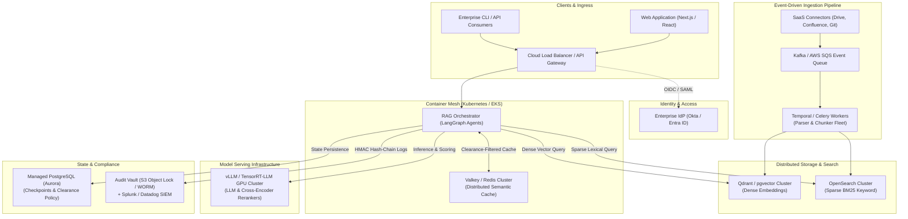

# Local Enterprise RAG Lab

An enterprise-ready, fully local **Compound AI** retrieval, reasoning, and compliance engine built with **LangGraph**, **Ollama (`qwen2.5-coder:7b`)**, **ChromaDB**, **SQLite FTS5 / BM25**, and **PostgreSQL / SQLite**.

Designed for complete data sovereignty, this system operates **100% air-gapped** with zero external network requests during inference. It integrates multi-tenant knowledge workspaces, self-reflective corrective RAG loops, multi-format document ingestion, and compliance-grade Human-in-the-Loop (HITL) review gates.

---

## Implemented AI Engineering Concepts

This repository serves as a reference implementation for key AI engineering patterns and production RAG architectures:

### 1. Compound AI Systems Architecture
Rather than treating LLM calls as a monolithic black box, the system orchestrates specialized, modular components: deterministic guardrails, semantic caching, intent routers, hybrid retrievers, document & hallucination graders, response generators, and compliance checkpoints.

### 2. Cyclic Agentic State Machines (LangGraph)
Uses **LangGraph** to model the RAG pipeline as a directed state graph (`GraphState`) featuring conditional branching, state cycles (retries and query rewriting loops), and durable execution interruptions.

### 3. Self-Reflective RAG (Self-RAG)
Implements dynamic self-assessment loops to verify output quality before answers are finalized:
* **Document Relevance Grading (`grade_docs`)**: Evaluates whether retrieved chunks contain sufficient relevant information to answer the question.
* **Hallucination Detection (`grade_hallucination`)**: Validates that generated statements are factually grounded in the retrieved citations.
* **Answer Relevance Grading (`grade_relevance`)**: Assesses whether the final answer directly addresses the original user prompt.

### 4. Corrective RAG (CRAG) & Adaptive Query Rewriting
When retrieved documents fail relevance grading or an answer is found irrelevant, the pipeline autonomously reformulates the user query (`rewrite`) and retries retrieval.

An answer that fails the groundedness check is regenerated from the same documents with the grader's reason added to the prompt (for example, the figures it stated that the context does not contain), because at temperature 0 an identical prompt would only repeat the same answer. The extractive fallback is never retried: it escalates straight to review. Two separate **circuit breakers** bound the loops: `MAX_RETRIEVAL_RETRIES` (default 2) for query rewrites and `MAX_GENERATION_RETRIES` (default 1) for regenerations, so one loop cannot spend the other's budget. Deployments running larger models can raise them in `.env`.

### 5. Hybrid Retrieval & Cross-Encoder Reranking
Combines dense vector embeddings, sparse lexical search, and neural cross-encoder reranking:
* **Dense Retrieval**: Cosine similarity via ChromaDB and fast local embeddings (ONNX `bge-small-en-v1.5`).
  Set `EMBEDDING_PROVIDER=ollama` to embed with `nomic-embed-text` instead. The two models produce vectors of different sizes, so there is no automatic switch between them: each index records the model that built it, and retrieval skips dense search with a labelled warning until the workspace is re-indexed (`make sync FORCE=1`).
* **Sparse Retrieval**: Lexical term matching via SQLite FTS5 / BM25 for exact matches, technical acronyms, and identifiers.
* **Reciprocal Rank Fusion (RRF)**: Merges candidate sets into an initial top candidate list.
* **Neural Cross-Encoder Reranker (`rag_lab/retrieval/reranker.py`)**: Shortlisted candidates undergo deep cross-attention re-scoring with a local, pinned ONNX model (`Xenova/ms-marco-MiniLM-L-6-v2`) to ensure that chunks directly answering the query are prioritized above partial keyword distractions.

### 6. Retrieval Abstention & Evidence Thresholds ("Knowing When Not to Answer")
To prevent hallucinations on irrelevant context, the system enforces strict evidence thresholds:
* Cosine similarity cutoff ($\ge 0.65$) or query token keyword coverage ($\ge 40\%$).
* If retrieved chunks fail these criteria, the system cleanly **abstains** (explaining that documentation was not found) instead of fabricating answers from unrelated context.

### 7. State-Scoped & Clearance-Partitioned Semantic Caching
* Approved query responses and their citations are cached in memory using a composite key: `hashlib.sha256(f"{workspace_id}:{clearance}:{index_fingerprint}:{original_question}")`.
* Partitioning by user clearance ensures a lower-clearance user never hits a cached answer generated from higher-clearance documents, while keying on `original_question` ensures queries rewritten during CRAG loops still hit the cache on subsequent asks.
* Re-indexing or updating documents automatically rotates `index_fingerprint`, guaranteeing instant cache invalidation with zero stale data served.

### 8. Dynamic Intent Classification & Routing
An intent router classifies incoming queries into **domain RAG** vs. conversational **chitchat**, bypassing vector retrieval for general interactions to conserve compute and avoid noise.

### 9. AI Safety, Prompt Injection Defense & Outbound DLP
* **Direct & Indirect Prompt Injection Defense**: Pre-retrieval heuristics detect direct user jailbreaks (`guardrail`). Post-retrieval context scanning (`sanitize_context`) strips untrusted documents containing role spoofing, delimiter attacks, instruction overrides, and exfiltration beacons prior to generator evaluation.
* **Real-Time Outbound Data Loss Prevention (DLP)**: Generated LLM responses undergo real-time redaction for emails, phone numbers, and sensitive identifiers before release. Audit logs are cryptographically hash-chained and PII-masked.

### 10. Human-in-the-Loop (HITL) Compliance & Dual-Control Gates
* The state graph pauses before answer release at a compliance checkpoint node.
* **Dual-Control Enforcement**: Reviewers must authenticate to approve or reject responses, and requesters are strictly prohibited from approving their own queries.
* Workflows can be resumed via either the web interface or terminal CLI (`rag_lab/ops/approve.py`).

### 11. Deterministic Source Provenance & Citations
Every answer sentence is tied back to traceable chunk keys (`[workspace_doc_chunk]`) and original source files, rendered in the UI with expandable citation cards for instant auditability.

### 12. Offline Benchmarking & LLM-as-a-Judge Evaluation Gate
An offline evaluation suite (`rag_lab/ops/eval.py`, `rag_lab/ops/eval_metrics.py`) benchmarks retrieval precision, keyword recall, groundedness, answer rate, and abstention accuracy against golden evaluation datasets (`eval/golden.json`), with optional LLM-as-a-judge support checks.

### 13. Multi-Tenant Knowledge Isolation & Document-Level RBAC
* **Workspace Isolation**: Workspaces (e.g., `accounting`, `legal`, `engineering`) are partitioned into isolated vector collections (`ws_<workspace_id>`) and independent SQLite FTS5 indices, preventing cross-tenant data leakage.
* **Document-Level Clearance Filtering**: Documents declare hierarchical clearance tags (`public`, `internal`, `confidential`, `secret`) in frontmatter or headers (unrecognized tags fail closed during ingestion). Vector search (`ChromaDB where` + post-query guard) and keyword search (`SQLite FTS5 WHERE clearance IN (...)`) strictly enforce the caller's authorized clearance, rendering classified documents completely invisible to unauthorized users.

### 14. Model Weight Pinning, Optional Rust Acceleration & Graceful Degradation
* Embedding and cross-encoder reranker weights are verified against pinned SHA-256 hashes (`rag_lab/security/model_integrity.py`).
* **Optional Native Rust Accelerator (`crates/rag_accel`)**: Compiles via PyO3/Maturin (`make rust-build`) to accelerate indirect prompt-injection scanning (`RegexSet` single-pass automaton) and document chunking (`split_text`) with 100% parity and automatic zero-config fallback to pure Python.
* If the primary LLM, cross-encoder, or vector store is unreachable, the system enters a degraded mode with transparent extractive fallbacks and visible warnings rather than failing silently.

---

## Architecture Flow

```
[START]
   │
[guardrail] ──(fail)──> [END] (Adversarial Prompt Violation)
   │ (pass)
[cache_lookup] ──(hit)──> [END] (Direct Semantic Cache Hit)
   │ (miss)
[router] ──(chitchat)──> [chitchat] ──> [END]
   │ (rag)
[retrieve] (Hybrid ChromaDB Dense + SQLite FTS5 / BM25 Sparse)
   │
[sanitize_context] (Zero Trust Indirect Prompt Injection Defense)
   │
[grade_docs] ──(rewrite)──> [rewrite] ──> [retrieve]
   │ (approved / max retries)
[generate]
   │
[grade_hallucination] ──(retry + grader feedback)──> [generate]
   │ (grounded)          └──(circuit break)──> [human_approval]
[grade_relevance] ──(irrelevant)──> [rewrite]
   │ (relevant / circuit break)
[human_approval] (HITL Compliance Checkpoint)
   │
 [END]
```

The generated topology is [`docs/architecture.mmd`](docs/architecture.mmd) (`make graph`); a test fails when it no longer matches the code.

---

## Usage Instructions

### 1. Prerequisites & Environment Setup

* **Python**: `>= 3.11` (tested up to 3.14)
* **Ollama** (optional, recommended for local generative LLM): `make ollama-pull` pulls the chat model (`qwen2.5-coder:7b`) and the alternative embedding model (`nomic-embed-text`)
* **Rust Toolchain** (optional, for compiling the native `rag_accel` PyO3 extension)
* **Docker** (optional, only if using PostgreSQL checkpointer instead of default SQLite)

```bash
# 0. View all available make commands
make help

# 1. Create virtual environment and install dependencies
make setup

# 2. Download and verify pinned embedding & reranker models (requires network once)
make models

# 3. Verify cached model weights offline
make verify-models

# 4. (Optional) Compile native Rust accelerator for high-throughput context scanning & chunking
make rust-build

# 5. Inspect full system status (models, accelerator, LLM, RBAC, workspaces, audit health)
make status
```

---

### 2. User Accounts & Role-Based Access Control (RBAC)

Nothing is reachable without a signed-in account. Passwords are hashed with **scrypt** with automatic hash upgrades.

**Review modes.** A fresh install runs in **open** mode: the global defaults are `query` + `auto_approve`, so every account can chat on every workspace and answers that pass every automated check are released without a person reading them. Answers that fail a check still pause for review. For team use, appoint at least one reviewer and run `make team-mode ADMIN=<admin>`: it removes only `auto_approve` from the defaults, so answers wait for a reviewer unless an account holds `auto_approve` through its own grants. `make status`, `make users` and the admin panel show the current mode, and flag workspaces where a paused answer could not be decided (no reviewer, only the requester as reviewer, or no reviewer cleared as high as the requester), and warn when a shared install in open mode has confidential or secret documents indexed.

All operations can be managed directly via `make` commands without activating the virtual environment:

```bash
# Create an administrator account (required for indexing and sync)
make add-user ACCOUNT=alice ADMIN=1

# Create standard analyst accounts with clearance levels (public, internal, confidential, secret)
make add-user ACCOUNT=bob CLEARANCE=internal
make add-user ACCOUNT=charlie CLEARANCE=public

# Update a user's clearance level
make set-clearance ACCOUNT=bob CLEARANCE=confidential

# Grant workspace-specific permissions ('query', 'review', or both)
# Accepts a single workspace, comma-separated list, or 'all'
make grant ACCOUNT=bob WS=accounting PERMS=query,review
make grant ACCOUNT=bob WS=accounting,strategy PERMS=query,review
make grant ACCOUNT=charlie WS=all PERMS=query

# Revoke access to workspaces (accepts a single workspace, comma-separated list, or 'all')
make revoke ACCOUNT=charlie WS=accounting
make revoke ACCOUNT=bob WS=all

# List accounts, clearance, and assigned permissions (never displays hashes)
make users

# Require human review by default once a reviewer is appointed
make grant ACCOUNT=bob WS=all PERMS=query,review ADMIN=alice
make team-mode ADMIN=alice

# Reset an account password (prompts securely)
make set-password ACCOUNT=bob

# Delete an individual user and all their grants
make delete-user ACCOUNT=bob
# Or bypass confirmation prompt:
make delete-user ACCOUNT=bob YES=1

# Delete ALL user accounts and grants
make reset-users
# Or bypass confirmation prompt:
make reset-users CONFIRM=yes
```

---

### 3. Workspace Management & Document Ingestion

Place `.md`, `.txt`, `.pdf`, `.docx`, or other supported files in dedicated folders under `knowledge_base/<workspace>/` (or manage workspaces directly via `make`):

```bash
# List all workspaces with file counts, chunk counts, and FTS5 index status
make workspaces

# Create or delete a workspace from the CLI
make create-workspace WS=legal
make delete-workspace WS=legal YES=1

# Sync all workspace directories (requires admin credentials)
make sync ADMIN=alice

# Sync a single workspace (auto-discovers knowledge_base/<ws>/ or accepts a custom DIR, plus optional FORCE=1)
make sync ADMIN=alice WS=accounting
make sync ADMIN=alice WS=accounting DIR=./knowledge_base/accounting FORCE=1
```

* Workspaces are automatically sanitized (e.g., `Accounting & Tax` becomes `accounting_tax`).
* Generates Chroma collections (`ws_<workspace_id>`) and SQLite FTS5 keyword indexes (`bm25_indices/<workspace_id>.db`).
* Idempotent: unchanged files are automatically skipped based on SHA-256 manifests.

---

### 4. Interactive Web Application

Launch the Streamlit web interface:

```bash
make ui ADMIN=alice
# Or launch without re-indexing:
make ui
```

Open `http://localhost:8501` in your browser:
1. **Sign In**: Authenticate with your username and password to obtain an HMAC-signed session token.
2. **Select Workspace**: Switch between permitted workspaces in the sidebar.
3. **Ask Questions**: Submit natural language queries.
4. **Inspect Citations**: Expand citation cards beneath responses to verify exact chunk origins and document text.
5. **Human Review Drawer**: If an answer requires compliance sign-off, authorized reviewers can approve or reject the output directly in the UI.

---

### 5. Compliance Review (Human-in-the-Loop)

Pending Human-in-the-Loop review threads can be managed directly via `make` commands. Under Separation of Duties, a query must be approved by an authorized reviewer with `review` permissions other than the requester:

```bash
# List all threads awaiting compliance approval
make reviews

# Interactively review a paused thread (prompts to approve/reject and records decisions)
make review
# Or specify a thread and reviewer:
make review THREAD=ui-accounting-uuid ACCOUNT=bob

# Directly approve a paused thread
make approve THREAD=ui-accounting-uuid ACCOUNT=bob REASON="Verified against policy"

# Directly reject a paused thread
make reject THREAD=ui-accounting-uuid ACCOUNT=bob REASON="Outdated policy cited"
```

---

### 6. Security, Auditing & Governance Operations

All system events (queries, guardrail checks, retrievals, and human decisions) are committed to a tamper-evident, append-only SQLite audit log (`data/audit.db`) with AES-256-GCM encrypted payloads.

```bash
# Verify the cryptographic HMAC audit hash chain
make audit-verify

# Inspect recent audit events (optional N=<count> and WS=<workspace>)
make audit-tail
make audit-tail N=50 WS=accounting

# Inspect answers rejected by human reviewers along with reasons
make audit-feedback
make audit-feedback N=20 WS=accounting

# Anchor the audit head hash (run periodically to detect truncation)
make audit-anchor

# Export decrypted audit trail as JSONL (to stdout or OUT=<file>)
make audit-export OUT=audit-export.jsonl

# Apply data retention policy (prunes audit logs and idle threads > 183 days by default)
make retention
make retention DAYS=90

# Create, list, and verify consistent checksummed snapshot backups (keys excluded)
make backup
make backups
make backup-verify DIR=backups/backup-<timestamp>

# Zero-trace factory reset (wipes all users, audit logs, checkpoints, keys, and vectors)
make factory-reset
# Or bypass confirmation prompt:
make factory-reset CONFIRM=yes
```

---

### 7. Evaluation & Test Suite

Verify system health, offline compliance, and retrieval quality:

```bash
# Run full unit and integration test suite
make test

# Run test suite with all outbound sockets blocked
make test-offline

# Run offline RAG benchmark evaluation (eval/golden.json)
make eval

# Run evaluation with local Ollama LLM-as-a-judge support checks
make eval-judge

# Print retrieval similarity and keyword coverage signals on the calibration split
make eval-calibrate

# Export LangGraph architecture diagram to docs/architecture.mmd
make graph
```

---

### 8. Storage Architecture & Docker Evaluation

The engine supports two storage topologies for persisting LangGraph conversation state and checkpoints:

#### Default Mode: Embedded SQLite (Zero-Ops & Self-Contained)
* **Status:** Default out-of-the-box (`data/checkpoints.db`).
* **Operational Footprint:** **Zero Docker required.** Checkpoints, audit trails (`data/audit.db`), and FTS5 keyword indices run natively as embedded SQLite databases with Write-Ahead Logging (WAL) and AES-256-GCM encryption-at-rest.

#### Optional Mode: PostgreSQL via Docker Compose (`make up`)
The repository includes a `docker-compose.yml` to run PostgreSQL (`postgres:16-alpine`) as an external checkpointer (`DB_URI=postgresql://...`).

**Is Dockerized PostgreSQL "Enterprise-Ready"?**
* **For Small Teams (1 to ~30 people / Internal Air-Gapped Labs):**
  - **Verdict:**  **Practical & Recommended.**
  - Provides instant, reproducible database provisioning without cloud infrastructure overhead or cloud egress costs.
  - State is persisted to a Docker volume (`pgdata`), easily backed up via standard host snapshots or `pg_dump` jobs.
* **For Large Enterprise Teams (50+ to Thousands of users):**
  - **Verdict:** ⚠️ **Single-container Docker is NOT enterprise-ready.**
  - A standalone container on a single host lacks **High Availability (HA)**, automatic multi-AZ failover, read replica scaling, and point-in-time recovery (PITR).
  - **Recommended Enterprise Alternative:** Large enterprises should point `DB_URI` to a **Cloud-Managed Service** (AWS Aurora/RDS, GCP Cloud SQL, Azure Database for PostgreSQL) or deploy PostgreSQL via a **Kubernetes Database Operator** (e.g. [CloudNativePG](https://cloudnative-pg.io/) or [Crunchy Data PGO](https://access.crunchydata.com/documentation/postgres-operator/latest/)) with continuous WAL archiving (`pgBackRest` / `wal-g`).

---

## 9. Scaling Beyond a Single Host: Cloud Architecture & Modern Stack

While **Local Enterprise RAG Lab** is engineered as a zero-cost, self-contained 10/10 appliance for local workstations and air-gapped team servers, growing organizations often face requirements that justify migrating to a distributed cloud architecture.

### When & Why to Scale to the Cloud

1. **Document Volume & Index Memory Footprint (Beyond Single-Host RAM)**
   - *Local Constraint*: ChromaDB and SQLite FTS5 operate in-process. For corpora with tens of thousands of chunks (a few gigabytes), local memory is ideal. However, indexing millions of documents (tens of millions of chunks, terabytes of dense vector embeddings) exhausts single-host RAM and disk I/O.
   - *Cloud Driver*: Distributed vector databases partition and shard vector indexes (HNSW/IVF) across clustered nodes with distributed memory management and zero-downtime node rebalancing.

2. **High Concurrent Query Volume (Horizontal Autoscaling)**
   - *Local Constraint*: A single workstation or server comfortably handles 1 to 5 simultaneous queries. Under dozens or hundreds of concurrent users, embedding generation, cross-encoder reranking, and LLM token generation compete for CPU/GPU cores, causing latency spikes and queuing.
   - *Cloud Driver*: Containerized microservices running behind cloud load balancers auto-scale pod replicas horizontally (using KEDA based on request queue depth or CPU/GPU utilization), delivering steady sub-second p95 latencies under peak traffic.

3. **Frontier Models & Multi-GPU Infrastructure**
   - *Local Constraint*: Local inference is constrained to compact quantized models (e.g. `qwen2.5-coder:7b`, `llama-3.1:8b`) running on CPU or consumer GPU memory.
   - *Cloud Driver*: Dedicated GPU node pools (e.g. NVIDIA H100, A100, L4) running high-throughput inference engines (**vLLM**, **TensorRT-LLM**, **Triton**) enable deploying 70B+ open models or privately proxying frontier LLMs (Claude 3.5 Sonnet, GPT-4o) with advanced multi-step reasoning.

4. **High Availability (HA), Multi-AZ Redundancy & 99.99% SLAs**
   - *Local Constraint*: A single local machine is a Single Point of Failure (SPOF). Power loss, hardware failure, or OS updates cause total downtime.
   - *Cloud Driver*: Multi-Availability Zone (Multi-AZ) clustering with managed database replication (e.g. AWS Aurora / GCP Cloud SQL), automated health checks, self-healing pod restarts, and Continuous Point-in-Time Recovery (PITR) to guarantee contractual enterprise uptime SLAs.

5. **Multi-Region Latency & Data Residency Compliance**
   - *Local Constraint*: All users connect to a single geographic location. Distributed remote teams experience high round-trip latency.
   - *Cloud Driver*: Deploying edge nodes behind Anycast routing (e.g. Cloudflare) serves queries close to users while enforcing strict geographical data boundaries (e.g., EU-only storage and inference for GDPR, US-only for HIPAA/ITAR).

6. **Continuous Event-Driven Ingestion from SaaS Ecosystems**
   - *Local Constraint*: Ingestion relies on batch triggers (`make sync`) or manual file uploads into workspace directories.
   - *Cloud Driver*: Real-time event streams (Apache Kafka, AWS SQS, Webhooks) connect directly to enterprise SaaS tools (Google Drive, SharePoint, Confluence, Jira, GitHub, Slack) to continuously parse, chunk, and index document edits as they happen via distributed worker workflows (Temporal, Celery).

7. **Enterprise SSO Federation & Centralized SIEM Auditing**
   - *Local Constraint*: Local scrypt passwords and HMAC-signed session tokens managed via `rag_lab/security/access.py`.
   - *Cloud Driver*: Direct federation with corporate Identity Providers (IdPs) via SAML 2.0 / OIDC (Okta, Microsoft Entra ID / Azure AD, Google Workspace), automated SCIM user provisioning, and real-time audit log streaming to enterprise SIEM platforms (Splunk, Datadog, AWS CloudWatch).

---

### Suggested Modern Cloud Stack Topology

To preserve this project's security invariants (Zero Trust clearance isolation, Self-RAG verification, four-eyes HITL review, and audit logging) while scaling horizontally, the following modern cloud architecture is recommended:

| Layer | Local Appliance (Current) | Cloud Enterprise Equivalent | Key Capabilities |
| :--- | :--- | :--- | :--- |
| **Orchestration & Compute** | Local Python runtime & Streamlit | **Kubernetes (EKS / GKE / AKS) + KEDA** | Horizontal Pod Autoscaling, stateless workers, rolling zero-downtime updates |
| **Vector Database** | Embedded ChromaDB (in-process) | **Qdrant Cluster** or **pgvector on AWS Aurora** | Sharded HNSW indexing, billions of vectors, multi-tenant payload filtering |
| **Sparse Lexical Search** | SQLite FTS5 with BM25 ranking | **OpenSearch / Elasticsearch Cluster** | Distributed inverted index, cross-region search, tokenizers for all languages |
| **State & Checkpoints** | Embedded SQLite WAL (`checkpoints.db`) | **Managed PostgreSQL (Aurora Serverless / Cloud SQL)** | Multi-AZ failover, automated continuous backup (PITR), connection pooling |
| **Semantic & Response Cache** | SQLite float32 packed vector cache | **Valkey / Redis Cluster with Vector Search** | Distributed sub-millisecond LRU cache with multi-node clearance isolation |
| **Model Inference Engine** | Local Ollama (`qwen2.5-coder:7b`) / CPU ONNX | **vLLM / TensorRT-LLM on GPU Pools (A100/H100)** | Continuous batching, PagedAttention, 20x higher throughput, 70B+ models |
| **Ingestion Pipeline** | Batch CLI (`rag_lab/ingestion/ingest.py`) & child processes | **Temporal.io / Celery + Apache Kafka / SQS** | Distributed asynchronous parsing, rate-limited chunking, dead-letter queues |
| **Identity & Access** | Local `access_policy.json` (scrypt + HMAC) | **Okta / Microsoft Entra ID (OIDC / SAML 2.0)** | Enterprise SSO, SCIM automated provisioning, MFA enforcement |
| **Audit & Observability** | Tamper-evident HMAC SQLite log + anchors | **OpenTelemetry + Splunk / Datadog / CloudWatch** | Immutable cloud audit vaults (S3 Object Lock / WORM), distributed tracing |
| **User Interface & API** | Streamlit web UI & CLI | **FastAPI Async Gateway + React / Next.js SPA** | Server-Sent Events (SSE) streaming, WebSocket push, responsive web UX |



---

## Repository Structure

```text
local-rag-lab/
├── pyproject.toml           # Declarative PEP 517/518/621 package & tool configurations
├── ui.py                    # Streamlit launcher (runs rag_lab/ui/streamlit_app.py)
├── rag_lab/                 # The package; data stays at the repo root (rag_lab.ROOT / RAG_LAB_HOME)
│   ├── config.py            # One mutable `settings` object built from the environment, read at call time
│   ├── pipeline/            # LangGraph Self-RAG: state, entry, retrieval, generation, grading, review, graph
│   │                        #   + llm_provider (Ollama / OpenAI-compatible / extractive fallback)
│   ├── retrieval/           # Embeddings, FTS5 keyword index, cross-encoder reranker, semantic cache
│   ├── ingestion/           # Indexer, format parsers, sandboxed parser worker
│   ├── security/            # Accounts & RBAC, AES-GCM vault, hash-chained audit, redaction, injection scan, model pins
│   ├── storage/             # Checkpointer, workspaces, backups, retention
│   ├── ops/                 # approve (HITL CLI), eval + metrics, graph export, model download
│   └── ui/                  # Streamlit page
├── crates/rag_accel/        # Optional native Rust PyO3 accelerator (context scanning & chunking)
├── Makefile                 # Unified setup, test, sync, UI, review, and audit workflows
├── docker-compose.yml       # Optional PostgreSQL container for durable checkpoints
├── eval/                    # Golden test dataset and benchmark corpus
├── knowledge_base/          # Multi-tenant knowledge base folders
└── tests/                   # Comprehensive test suite (240+ unit, integration, and security tests)
```

---

## License

Apache-2.0
