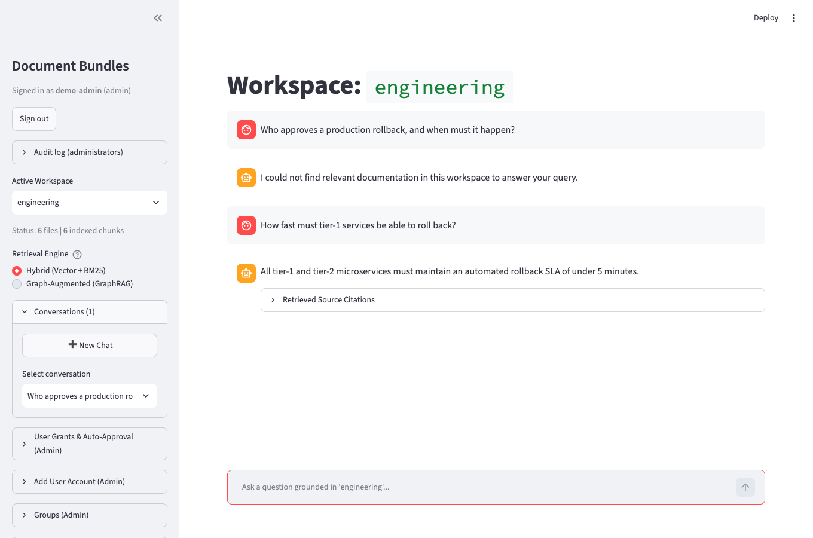

# Local RAG Lab

A local, offline retrieval-augmented generation pipeline (LangGraph) that checks every answer sentence against its sources with an NLI model, in English, German, French and Greek, with a measured evaluation harness. It is a single-author lab project run on one machine, **not a deployed product**: nobody else uses it, and its benchmark corpus is synthetic and written by the author.



*Streamlit UI on the synthetic `engineering` workspace, answers from the deterministic extractive answerer (no LLM), throwaway accounts.*

## What it does

- **Self-correcting pipeline:** guardrail, cache, router, hybrid retrieval (dense + SQLite FTS5/BM25, reranker), relevance and groundedness grading, query rewriting and regeneration with bounded retries, then release or human review.
- **Grounding by sentence:** figures absent from the sources are rejected first, then each answer sentence must be entailed by a source sentence (pinned fp32 multilingual NLI model).
- **Offline at runtime:** no network after `make models` (`HF_HUB_OFFLINE=1`). Models are pinned by SHA-256. Chat model: Ollama (`qwen3:8b`) or any OpenAI-compatible server.
- **Access control:** roles, per-document clearance, signed session tokens, hash-chained audit log, human review for answers that fail a check. Threat model: [docs/threat-model.md](docs/threat-model.md).

```text
[START] ──> [guardrail] ──(fail)──> [END]
                 │ (pass)
          [contextualize]   (follow-up -> standalone question)
                 │
           [cache_lookup] ──(hit)──> [END]
                 │ (miss)
             [router] ──(chitchat)──> [chitchat] ──> [END]
                 │ (rag)
             [retrieve] <──────── [rewrite] <──────────────────┐
                 │                    ▲                        │
          [sanitize_context]          │                        │
                 │                    │                        │
            [grade_docs] ──(rewrite)──┘                        │
                 │ (approved | circuit_break)                  │
             [generate] <────────────────────┐                 │
                 │                           │ (retry)         │
        [grade_hallucination] ───────────────┘                 │
                 │ (grounded)                                  │
          [grade_relevance] ──(irrelevant)─────────────────────┘
                 │ (relevant | circuit_break)
          [human_approval] ──> [END]
```

The generated topology is [`docs/architecture.mmd`](docs/architecture.mmd) (`make graph`); a test fails when it goes stale.

## Measured findings

Details and tables: [eval/README.md](eval/README.md). Rationale for each design choice, and which ones were never measured: [docs/design-decisions.md](docs/design-decisions.md).

1. **int8 NLI weights give different verdicts on different CPUs.** CI was the first run on another machine. On an AMD EPYC (x86) the int8 model scored a sentence 0.12 that an Apple-silicon Mac scored 0.93, and a false claim 0.64 instead of 0.01; 25 of 42 labelled claims differed by more than 0.1 between the two. The fp32 weights matched to under 0.0001, so the NLI model is pinned in full precision, and a test refuses quantized NLI weights. The price: 3 of 52 correct qwen3:8b answer sentences are now rejected and go to review.
2. **Candidate-pool size only matters at the extreme.** A 72-chunk near-duplicate stress suite (12 regional policy files with the same six limits) gave recall 0.92 at a pool of 1+1 and 1.00 from 2+2 up. The default 5+5 stays; a 20+20 pool took the median from 158 ms to 360 ms (one noisy run each) for no gain.
3. **Running the real model found a grader defect the deterministic run could not.** qwen3:8b answered the stress questions correctly, but only 1 of 12 answers passed the groundedness check, because the office name appeared only in a heading, which was never offered as an NLI premise. Titled premises fixed it (stress entailment 1.00).
4. **The Ollama embedding path was removed after measurement.** Against thresholds calibrated for the ONNX model it scored retrieval recall 0.75 and abstention accuracy 0.27 (gates: 0.9), could not be hash-pinned, and took 11 ms per query against 4.5 ms. Retrieval quality itself was close (recall@1 0.90 vs 0.93), and its integration never added the task prefixes `nomic-embed-text` expects, so the comparison is not clean.

## Quickstart

Needs Python 3.11–3.14, about 2 GB for the pinned models (network needed once), and optionally Ollama for real model answers.

```bash
make setup                    # virtualenv and dependencies
make models                   # download and verify the pinned models (the only network use)
make add-user ACCOUNT=me ADMIN=1   # first account becomes the owner; prompts for a password
make sync ADMIN=me            # index knowledge_base/ (prompts for the password)
make ui ADMIN=me              # Streamlit on 127.0.0.1
make test                     # 1,000+ tests; those needing Postgres, Qdrant or pgvector skip without them
make eval                     # offline benchmark gates over eval/golden.json
```

## Evaluation, and what it does not show

`make eval` runs the real LangGraph pipeline over a synthetic corpus (six workspaces, EN/DE/FR/EL) with a deterministic extractive answerer; CI gates it. Scores on the held-out test split are 1.00 on most metrics (`eval/README.md` lists them all), which means **the suite is saturated: it can catch regressions but cannot rank improvements**. The corpus and the questions have the same author, there is no public data in the gated suites, and the real-model run (`make eval-llm`) is weekly and non-blocking. For data the author did not write, `make eval-external` runs 895 cases from the public XQuAD benchmark (English, German, Greek; opt-in, ungated): the gold paragraph is cited in 851 of 895 and every sentence of 847 of 851 answers is entailed, but the gold answer span appears in only 708 (79%); with the right paragraph cited, the deterministic extractive answerer evidently often quotes another sentence. With the real model (qwen3:8b) the same-language span rate is 80.6% against 84.0%, entailment 94.4% against 100%; cross-lingual span scores are not meaningful because the model answers in the question's language. GraphRAG is experimental: on a 12-case multi-hop ablation it completed no chain and changed no answer (`make eval-graph`). Held-out counts with 95% intervals, the limits of each suite and the weaker numbers are in [eval/README.md](eval/README.md).

## More

- [docs/design-overview.md](docs/design-overview.md): self-assessed scorecard, the fourteen techniques, repository layout
- [docs/usage.md](docs/usage.md): accounts and roles, workspaces and ingestion, review, audit, storage, scaling notes
- [docs/scaling.md](docs/scaling.md), [docs/lan-tls.md](docs/lan-tls.md), [docs/threat-model.md](docs/threat-model.md)

## License

Apache-2.0 ([LICENSE](LICENSE)). The XQuAD slice in `eval/external/` is CC BY-SA 4.0 ([notice](eval/external/README.md)).
