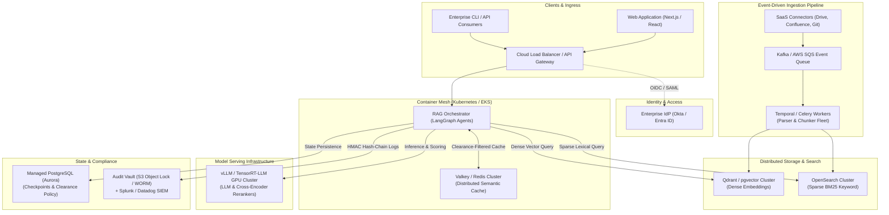

# Cloud roadmap (design sketch, not implemented)

> Nothing in this file is built, tested or measured. The lab runs on one machine; the options that exist today (Qdrant, pgvector, vLLM, a shared Postgres cache) are in [scaling.md](scaling.md). This is what a larger deployment might need, kept for reference.

### When & Why to Scale to the Cloud

1. **Document Volume & Index Memory Footprint (Beyond Single-Host RAM)**
   - *Local Constraint*: ChromaDB and SQLite FTS5 operate in-process. For corpora with tens of thousands of chunks (a few gigabytes), local memory is ideal. However, indexing millions of documents (tens of millions of chunks, terabytes of dense vector embeddings) exhausts single-host RAM and disk I/O.
   - *Cloud Driver*: Distributed vector databases partition and shard vector indexes (HNSW/IVF) across clustered nodes with distributed memory management and zero-downtime node rebalancing.

2. **High Concurrent Query Volume (Horizontal Autoscaling)**
   - *Local Constraint*: A single workstation or server comfortably handles 1 to 5 simultaneous queries. Under dozens or hundreds of concurrent users, embedding generation, cross-encoder reranking, and LLM token generation compete for CPU/GPU cores, causing latency spikes and queuing.
   - *Cloud Driver*: Containerized microservices running behind cloud load balancers auto-scale pod replicas horizontally (using KEDA based on request queue depth or CPU/GPU utilization), delivering steady sub-second p95 latencies under peak traffic.

3. **Frontier Models & Multi-GPU Infrastructure**
   - *Local Constraint*: Local inference is constrained to compact quantized models (e.g. `qwen3:8b`, `gemma4:12b`) running on CPU or consumer GPU memory.
   - *Cloud Driver*: Dedicated GPU node pools (e.g. NVIDIA H100, A100, L4) running high-throughput inference engines (**vLLM**, **TensorRT-LLM**, **Triton**) enable deploying 70B+ open models or privately proxying frontier LLMs (Claude 3.5 Sonnet, GPT-4o) with advanced multi-step reasoning.

4. **High Availability (HA), Multi-AZ Redundancy & 99.99% SLAs**
   - *Local Constraint*: A single local machine is a Single Point of Failure (SPOF). Power loss, hardware failure, or OS updates cause total downtime.
   - *Cloud Driver*: Multi-Availability Zone (Multi-AZ) clustering with managed database replication (e.g. AWS Aurora / GCP Cloud SQL), automated health checks, self-healing pod restarts, and Continuous Point-in-Time Recovery (PITR) to guarantee contractual enterprise uptime SLAs.

5. **Multi-Region Latency & Data Residency Compliance**
   - *Local Constraint*: All users connect to a single geographic location. Distributed remote teams experience high round-trip latency.
   - *Cloud Driver*: Deploying edge nodes behind Anycast routing (e.g. Cloudflare) serves queries close to users while enforcing strict geographical data boundaries (e.g., EU-only storage and inference for GDPR, US-only for HIPAA/ITAR).

6. **Continuous Event-Driven Ingestion from SaaS Ecosystems**
   - *Local Constraint*: Ingestion relies on batch triggers (`make sync`) or manual file uploads into workspace directories.
   - *Cloud Driver*: Real-time event streams (Apache Kafka, AWS SQS, Webhooks) connect directly to enterprise SaaS tools (Google Drive, SharePoint, Confluence, Jira, GitHub, Slack) to continuously parse, chunk, and index document edits as they happen via distributed worker workflows (Temporal, Celery).

7. **Enterprise SSO Federation & Centralized SIEM Auditing**
   - *Local Constraint*: Local scrypt passwords and HMAC-signed session tokens managed via `rag_lab/security/access.py`.
   - *Cloud Driver*: Direct federation with corporate Identity Providers (IdPs) via SAML 2.0 / OIDC (Okta, Microsoft Entra ID / Azure AD, Google Workspace), automated SCIM user provisioning, and real-time audit log streaming to enterprise SIEM platforms (Splunk, Datadog, AWS CloudWatch).

---

### Suggested Modern Cloud Stack Topology

To preserve this project's security invariants (Zero Trust clearance isolation, Self-RAG verification, four-eyes HITL review, and audit logging) while scaling horizontally, the following modern cloud architecture is recommended:

| Layer | Local Appliance (Current) | Cloud Enterprise Equivalent | Key Capabilities |
| :--- | :--- | :--- | :--- |
| **Orchestration & Compute** | Local Python runtime & Streamlit | **Kubernetes (EKS / GKE / AKS) + KEDA** | Horizontal Pod Autoscaling, stateless workers, rolling zero-downtime updates |
| **Vector Database** | Embedded ChromaDB (default); Qdrant or pgvector server, opt-in today | **Qdrant Cluster** or **pgvector on AWS Aurora** | Sharded HNSW indexing, billions of vectors, multi-tenant payload filtering |
| **Sparse Lexical Search** | SQLite FTS5 with BM25 ranking | **OpenSearch / Elasticsearch Cluster** | Distributed inverted index, cross-region search, tokenizers for all languages |
| **State & Checkpoints** | Embedded SQLite WAL (`checkpoints.db`) | **Managed PostgreSQL (Aurora Serverless / Cloud SQL)** | Multi-AZ failover, automated continuous backup (PITR), connection pooling |
| **Semantic & Response Cache** | SQLite float32 packed vector cache (shared PostgreSQL, opt-in today) | **Valkey / Redis Cluster with Vector Search** | Distributed sub-millisecond LRU cache with multi-node clearance isolation |
| **Model Inference Engine** | Local Ollama (`qwen3:8b`) or an OpenAI-compatible server such as vLLM (opt-in) / CPU ONNX | **vLLM / TensorRT-LLM on GPU Pools (A100/H100)** | Continuous batching, PagedAttention, 20x higher throughput, 70B+ models |
| **Ingestion Pipeline** | Batch CLI (`rag_lab/ingestion/ingest.py`) & child processes | **Temporal.io / Celery + Apache Kafka / SQS** | Distributed asynchronous parsing, rate-limited chunking, dead-letter queues |
| **Identity & Access** | Local `access_policy.json` (scrypt + HMAC) | **Okta / Microsoft Entra ID (OIDC / SAML 2.0)** | Enterprise SSO, SCIM automated provisioning, MFA enforcement |
| **Audit & Observability** | Tamper-evident HMAC SQLite log + anchors | **OpenTelemetry + Splunk / Datadog / CloudWatch** | Immutable cloud audit vaults (S3 Object Lock / WORM), distributed tracing |
| **User Interface & API** | Streamlit web UI & CLI | **FastAPI Async Gateway + React / Next.js SPA** | Server-Sent Events (SSE) streaming, WebSocket push, responsive web UX |

